# FinOps: Snowflake FOCUS Cost & Usage for Qlik Cloud

A Qlik Cloud Analytics app that monitors Snowflake consumption and spend across every account in a Snowflake organization, using Snowflake's billing data in the [FOCUS™](https://focus.finops.org) (FinOps Open Cost & Usage Specification) v1.3 format. Paired with Qlik's Discovery Agent, it detects cost anomalies after each reload and pushes them to users' Feed, before they reach the invoice.

## What is here

| File | What it is |
|---|---|
| `snowflake-focus-cost-usage.qvf` | The "Snowflake FOCUS Cost & Usage (v1.3)" app, exported **without data**: load script, sheets, charts, master items and variables. |

## What the app covers

The app reads one source, the [`SNOWFLAKE.BILLING.FOCUS_COST_USAGE_V1_3`](https://docs.snowflake.com/en/sql-reference/billing/focus_cost_usage_v1_3) view: daily charge lines per sub-account, service and charge type. It supports these FinOps capabilities:

- **Allocation**: spend by billing account, sub-account, service category, service, provider and region.
- **Reporting and analytics**: daily and monthly trends, sliceable across every FOCUS dimension.
- **Anomaly management**: statistical outliers by day and service, plus Discovery Agent insights.
- **Forecasting**: month-end projection from the settled month to date and the 7-day run rate.
- **Rate optimization**: List, Contracted, Billed and Effective Cost side by side.
- **Invoice reconciliation**: Billed Cost by billing period, with correction rows identified through `ChargeClass`.

### Sheets

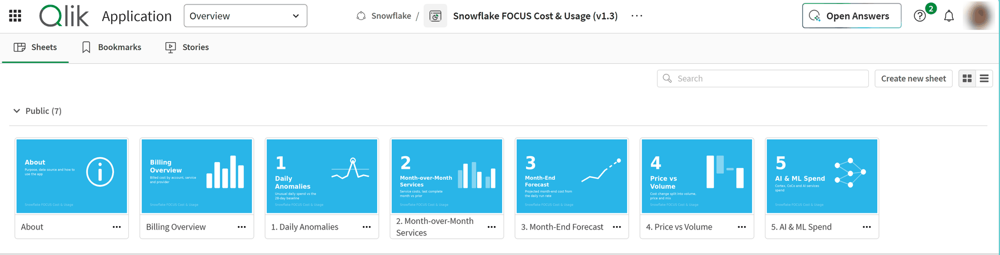

| Sheet | What it answers | Time window |
|---|---|---|
| About | Purpose, data source, freshness, cost definitions, access requirements | — |
| Billing Overview | Billed, Contracted and Effective Cost by account, service and provider | The Period selector (today, last week, this year, …) |
| 1. Daily Anomalies | Which days and services spent unusually (7-day average + 2σ band; z-score per sub-account, region and service, \|z\| > 2 flagged) | Latest settled day (3 days before reload) vs the 28 days before it |
| 2. Month-over-Month Services | How service costs changed month over month | M-1 vs M-2, plus month to date and forecast |
| 3. Month-End Forecast | Where the current month will land | Settled month to date + 7-day run rate × remaining days |
| 4. Price vs Volume | Whether a change came from usage (volume), rates (price) or new/dropped services (mix) | M-1 vs M-2 |
| 5. AI & ML Spend | What Cortex, Snowflake CoCo and other AI services cost: spend, share, credits, tokens | Current selections |

M-1 and M-2 are the 2nd and 3rd most recent months in the current selection (variables `vSAM-1`/`vSAM-2`). With nothing selected, they are the last complete month and the month before. Rates are always calculated per pricing unit, so credits, tokens and storage are never mixed.

<details>
<summary>Sheet screenshots</summary>

**About**

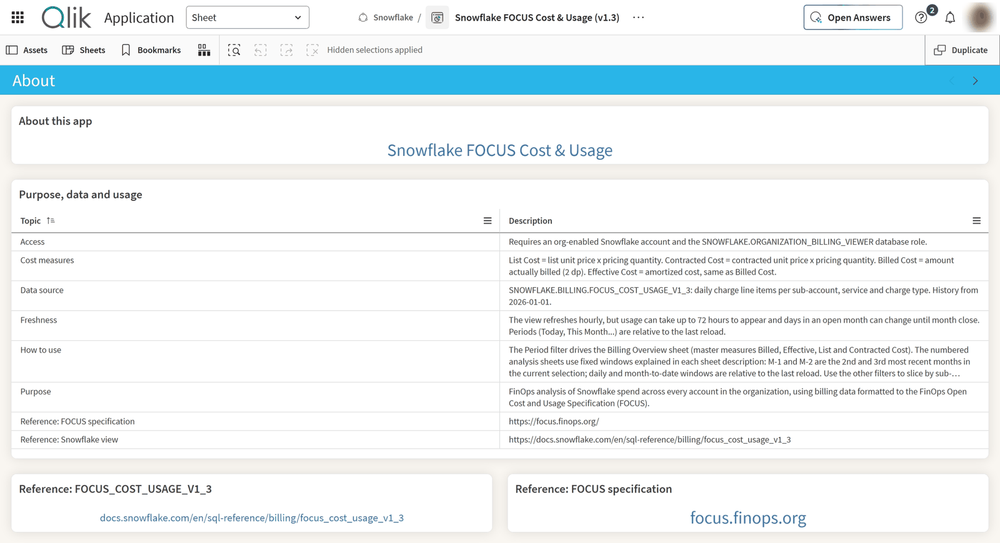

**Billing Overview**

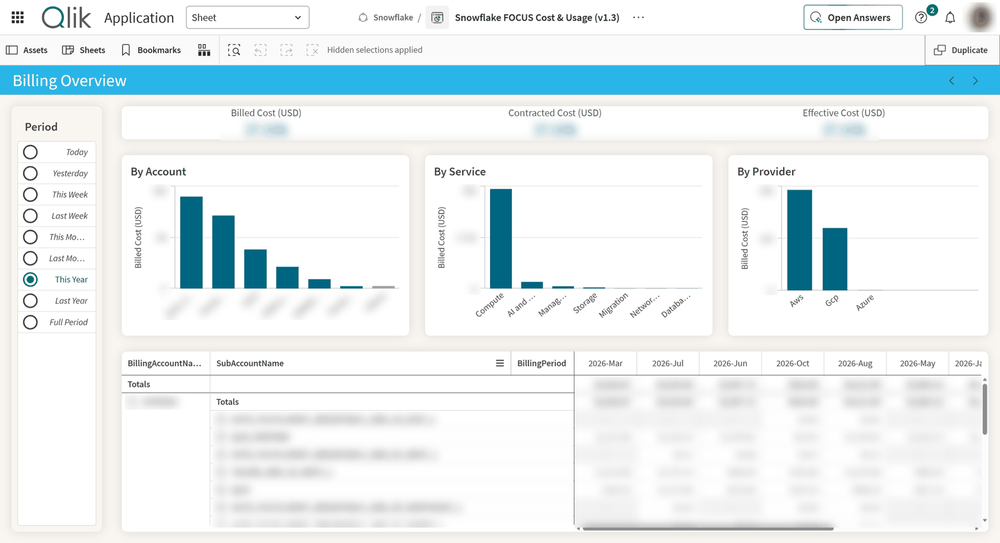

**1. Daily Anomalies**

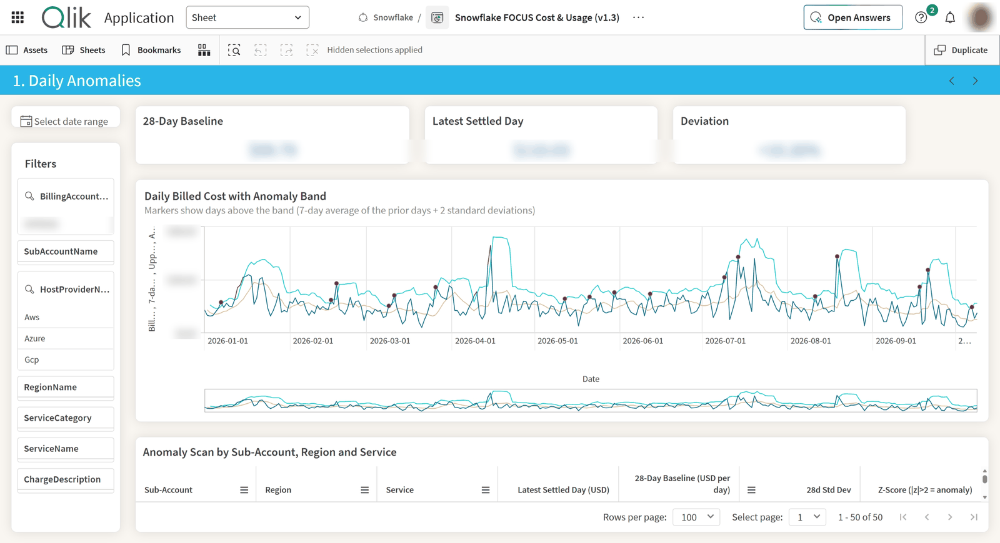

**2. Month-over-Month Services**

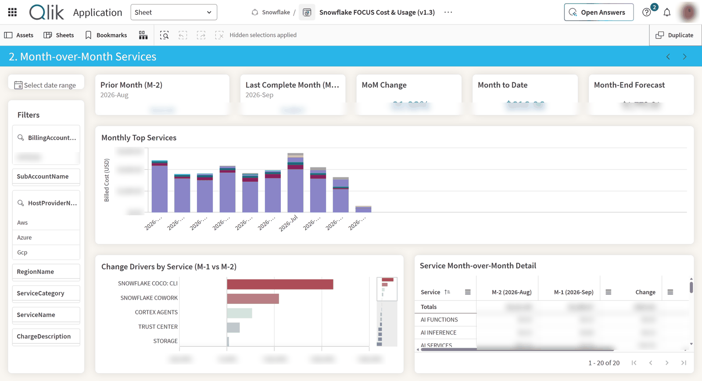

**3. Month-End Forecast**

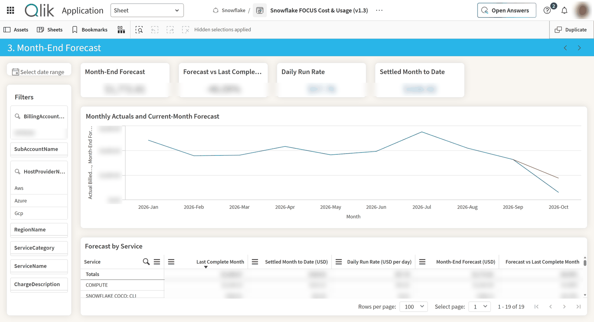

**4. Price vs Volume**

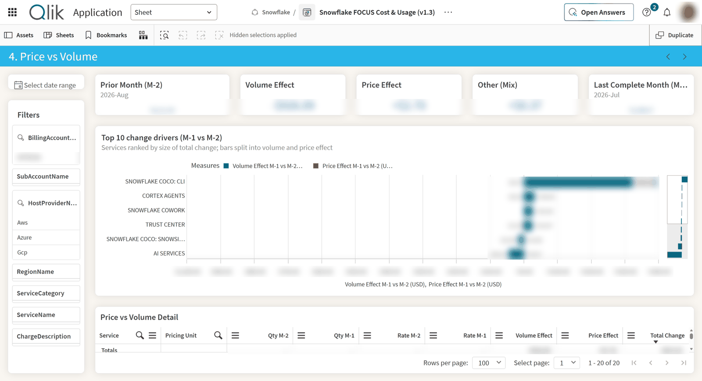

**5. AI & ML Spend**

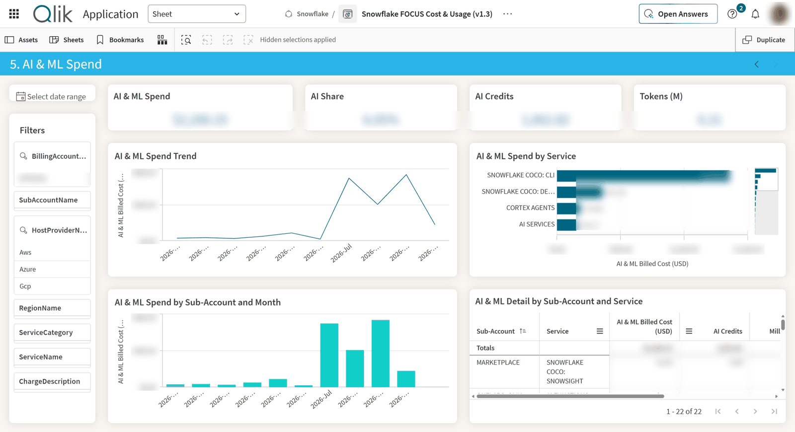

</details>

### Cost measures

| Measure | Meaning |
|---|---|
| Billed Cost | Drawn from the capacity balance; matches the Snowflake usage statement |
| Contracted Cost | Contracted unit price × pricing quantity |
| List Cost | Published rate; compare with Contracted Cost to see negotiated savings |
| Effective Cost | Amortized cost after commitment drawdown (equals Billed Cost in this view) |

All costs are in USD. The app also ships master measures for M-1/M-2 cost, month to date, run rate, month-end forecast, 28-day baseline, volume and price effects, and AI & ML cost, each with a description.

## Prerequisites

- A Qlik Cloud Analytics tenant (Discovery Agent is optional).
- A Snowflake account that is **org-enabled**, with a dedicated service user and role for Qlik.
- That role granted the billing database role:

  ```sql
  GRANT DATABASE ROLE SNOWFLAKE.ORGANIZATION_BILLING_VIEWER TO ROLE <role_name>;
  ```

  Check it with `SELECT * FROM SNOWFLAKE.BILLING.FOCUS_COST_USAGE_V1_3 LIMIT 10;`. Grant the role only to the Qlik service role; access inside Qlik is then governed by app and space permissions.

## Installing

### 1. Upload the app

1. In Qlik Cloud, go to **Create → Upload app** and choose `snowflake-focus-cost-usage.qvf`.
2. Pick a shared space (for example `Snowflake`) where you can create data connections. The connection you create next must be in the same space, or in a space the app can read.

The app arrives without data. Don't reload it yet: the connection it refers to doesn't exist in your tenant.

### 2. Create the Snowflake connection

1. Open the app and go to **Data load editor** (or, from the space, **Create → Data connection**).
2. Click **Create new connection** and choose **Snowflake**.
3. Fill in:

   | Setting | Value |
   |---|---|
   | Server | `<account_identifier>.snowflakecomputing.com` (the org-enabled account) |
   | Database | `SNOWFLAKE` |
   | Schema | `BILLING` |
   | Warehouse | A small warehouse the service role can use, e.g. `XSMALL` |
   | Role | The role granted `SNOWFLAKE.ORGANIZATION_BILLING_VIEWER` |
   | Authentication | Key pair (recommended) or OAuth, for the dedicated service user |

4. Name it `SNOWFLAKE_MONITORING_DATA`, choose the space, and click **Test connection**, then **Create**.

Credentials are stored in Qlik Cloud's encrypted secret store. Avoid using `ACCOUNTADMIN` or a personal user: a dedicated user and role with only the billing database role keep access narrow.

### 3. Update the load script

1. In **Data load editor**, open the **Main** tab and find:

   ```qlik
   LIB CONNECT TO 'Snowflake:SNOWFLAKE_MONITORING_DATA';
   ```

2. Change it to `'<SpaceName>:<ConnectionName>'` for your connection. If you used the name `SNOWFLAKE_MONITORING_DATA` in a space called `Snowflake`, no change is needed. The easiest way to get the exact string: in the **Data connections** panel on the right, click the connection's **Connect** (plug) icon and replace the existing line with the inserted one.
3. Optional settings on the same tab:
   - `SET FirstWeekDay=0;` sets weeks to start on Monday (`6` = Sunday). It drives `WeeksAgo` and "This Week"/"Last Week".
   - The `SET ... Sep` and `DateFormat` lines set number and date display; change them to your locale if you like.
4. Don't change the `SQL SELECT` column list or aliases in the **FOCUS Cost & Usage** tab: sheets and master measures depend on those field names.
5. Click **Load data**. The script reads the view and builds the relative-period fields (`DayRelNo`, `WeeksAgo`, `MonthsAgo`, `YearsAgo`) from the reload date.

If the reload fails:

| Error | Cause |
|---|---|
| Connection not found | The `LIB CONNECT` string doesn't match the space and connection name |
| `Object 'SNOWFLAKE.BILLING.FOCUS_COST_USAGE_V1_3' does not exist or not authorized` | The role lacks `ORGANIZATION_BILLING_VIEWER`, or the account isn't org-enabled |
| No warehouse / suspended warehouse | Set a warehouse on the connection and grant `USAGE` on it to the role |

### 4. Validate and schedule

1. Reconcile Billed Cost for a closed billing period against your Snowflake usage statement.
2. Schedule reloads in the app's **Reload** settings. Daily (for example 06:00 UTC) is a good start. The script reloads the full view each time, which is what the data needs: past days can change until month close.

### Optional: Discovery Agent

[Discovery Agent](https://help.qlik.com/en-US/cloud-services/Subsystems/Hub/Content/Sense_Hub/DiscoveryAgent/discovery-agent.htm) evaluates the app after each reload. It builds dynamic baselines (time-series forecasts with confidence intervals) per metric, suppresses routine variation, and uses the Qlik Associative Engine to locate where a change is concentrated, for example one sub-account and one service. Insights appear in each user's Feed in the Analytics Hub, with a plain-language description and a link to the app; Qlik Answers can then be used to explore them conversationally.

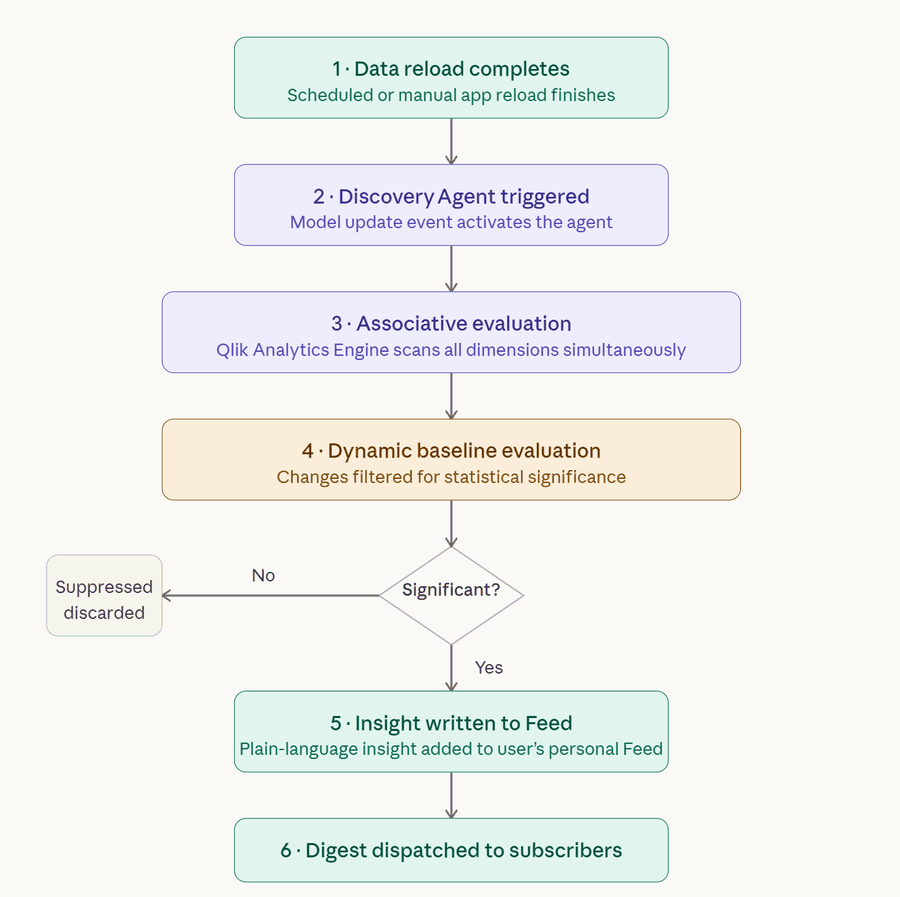

1. In the Qlik Cloud Administration console, enable cross-region data processing (required for the AI inference layer; the loaded billing data stays in the tenant's home region).
2. Assign the Discovery Agent role to the users or groups who should receive insights.
3. Enable Discovery Agent on the app and define insight triggers, for example Billed Cost and credit consumption by sub-account and service.

   A suggested starting point: one trigger group on Billed Cost (USD), time dimension `BillingPeriod`, daily/weekly/monthly periods, "value going up" marked negative, broken down by `BillingAccountName`, `ChargeDescription` and `HostProviderName`.

   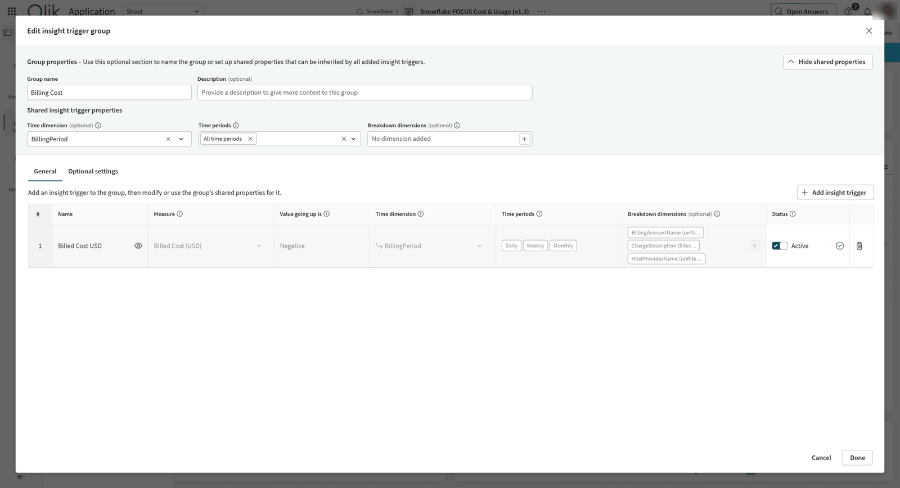

Discovery Agent respects app permissions: users only receive insights from apps they can open.

Insights in the Feed, here record-high Billed Cost by provider and charge description:

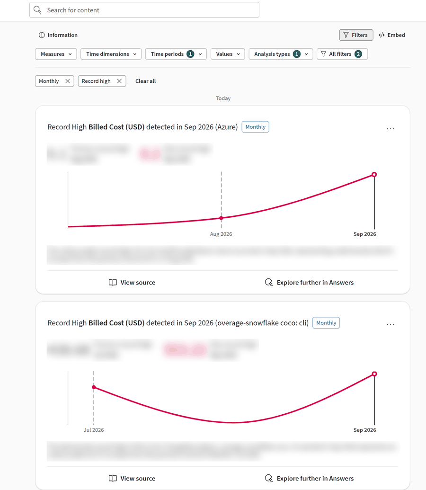

Exploring an insight further with Qlik Answers:

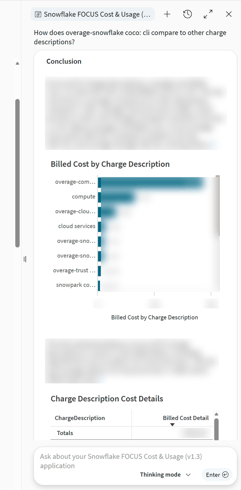

## Data freshness and limitations

- The view is a Snowflake **preview** feature.
- It refreshes hourly, but latent usage can take up to 72 hours to appear. Daily values can change until month close (adjustments, contract amendments, account transfers), so treat in-month numbers and forecasts as provisional.
- History starts on 2026-01-01.
- Resource-level, tag and SKU columns (`ResourceId`, `AllocatedTags`, `Sku*`) are not populated, and `InvoiceId` may be empty for capacity contracts. Allocation is therefore at account and service level; for finer chargeback, combine with `SNOWFLAKE.ACCOUNT_USAGE` views such as `WAREHOUSE_METERING_HISTORY`.

## Customizing

All sheets can be changed or removed. A few conventions keep the app consistent:

- Measure expressions carry no `Num()` formatting; number formats are set on the objects and master measures.
- Never divide cost by quantity across mixed `PricingUnit` values (`Credits`, `AI Credits`, `Million Tokens`, `TiB-Months`).
- Measures tied to the reload date ignore date selections; only Billing Overview follows the Period selector. Each sheet description states its time windows.
- Technical fields are hidden in the load script to keep the field list readable for users and AI assistants.

## Resources

- [Snowflake `FOCUS_COST_USAGE_V1_3` view](https://docs.snowflake.com/en/sql-reference/billing/focus_cost_usage_v1_3)
- [Qlik Discovery Agent documentation](https://help.qlik.com/en-US/cloud-services/Subsystems/Hub/Content/Sense_Hub/DiscoveryAgent/discovery-agent.htm)
- [FOCUS specification](https://focus.finops.org)
- [FinOps Foundation](https://www.finops.org)
- [Qlik Community](https://community.qlik.com)
